<div align="center">

# 📊 Censo Escolar — ETL + Dashboard com IA generativa

**Idade · Escolaridade · Localidade** dos alunos matriculados no Brasil,
do dado bruto do INEP a um painel público e gratuito.

[](etl/requirements.txt)
[](etl/requirements.txt)
[](dbt/censo_escolar)
[](dashboard/app.py)
[](dashboard/db.py)
[](dashboard/ai)
[-46E3B7?logo=render&logoColor=white)](dashboard/render.yaml)
[](https://www.gov.br/inep/pt-br/acesso-a-informacao/dados-abertos/microdados/censo-escolar)

</div>

---

Pipeline de dados completo sobre o **Censo Escolar da Educação Básica (INEP)**
— terminando num **dashboard público e gratuito**, embedável via `<iframe>`,
com um chat de **IA generativa** para perguntar sobre os dados em português.

## 🗺️ Arquitetura

```mermaid
flowchart LR
    subgraph fonte["🏛️ Fonte oficial"]
        INEP["INEP — microdados\nCenso Escolar 2019-2023\n(zip, CSV ; latin1)"]
    end

    subgraph local["⚙️ Processamento local (PySpark)"]
        LANDING["🧊 Landing\ndata/landing/{ano}/\nCSV bruto, como baixado"]
        BRONZE["🥉 Bronze\ndata/bronze/{tabela}/\nParquet tipado,\nencoding corrigido"]
        GOLD["🥇 Gold\ndata/gold/\nderiva rede + AGREGA\n(soma QT_MAT_* por\nmunicípio x rede x ano)"]
        LANDING -->|"02_landing_to_bronze.py"| BRONZE
        BRONZE -->|"03_bronze_to_gold.py"| GOLD
    end

    subgraph nuvem["☁️ Nuvem gratuita"]
        STAGING["Supabase Postgres\nschema staging\n(04_load_gold_to_postgres.py)"]
        DIAMOND["💎 dbt — schema diamond\nmarts por gráfico:\nidade · escolaridade\nlocalidade · série temporal"]
        DASH["📊 Dashboard Plotly Dash\n(Render, free tier)"]
        GEMINI["✨ Google Gemini\nchat + insights automáticos"]
    end

    EMBED["🌐 &lt;iframe&gt; em qualquer site"]

    INEP --> LANDING
    GOLD -->|"04_load_gold_to_postgres.py"| STAGING
    STAGING -->|"dbt run"| DIAMOND
    DIAMOND --> DASH
    GEMINI <--> DASH
    DASH --> EMBED
```



### As camadas, em uma frase cada

| Camada | O que acontece | Onde vive |
|---|---|---|
| 🧊 **Landing** | Zip/CSV do INEP, exatamente como baixado | Disco local (`data/landing/`) |
| 🥉 **Bronze** | CSV `;`/latin1 → Parquet tipado, sem lógica de negócio | Disco local (`data/bronze/`) |
| 🥇 **Gold** | Deriva `rede`, soma as colunas `QT_MAT_*` por município | Disco local (`data/gold/`) |
| 💎 **Diamond** | Marts finais, um por gráfico do dashboard | Supabase Postgres (via dbt) |
| 📊 **Dashboard** | Gráficos + KPIs + chat de IA, público e gratuito | Render (Docker, free tier) |

### Por que agregar antes do Postgres?

Desde 2019 o INEP já publica os microdados em nível de **escola** (não mais
por aluno) — cada escola tem colunas `QT_MAT_*` com a contagem de matrículas
já pré-agregada por idade, etapa de ensino, zona urbana/rural, sexo e
raça/cor. Ainda assim, isso é ~217 mil linhas (uma por escola) por ano — o
PySpark soma essas colunas por **ano x UF x município x rede**, reduzindo
para algumas dezenas de milhares de linhas, pequeno o suficiente para o free
tier do Supabase (500MB). Os marts `diamond_*` no dbt "despivotam" essas
colunas somadas em formato longo (uma linha por faixa etária/etapa/zona),
pronto para os gráficos do dashboard.

## 📁 Estrutura do repositório

```
etl/                      → scripts PySpark (landing → bronze → gold → load)
  config.py                 configura JAVA_HOME/HADOOP_HOME e caminhos (importar antes do pyspark)
  schema_mappings/          harmonização de nomes de coluna entre anos do INEP
dbt/censo_escolar/        → projeto dbt (staging → intermediate → diamond)
dashboard/                → app Plotly Dash + IA generativa (Gemini)
  ai/chat.py                chat de perguntas em linguagem natural (text-to-SQL)
  ai/insights.py            resumo automático gerado para cada gráfico
embed/exemplo_embed.html  → snippet pronto para embedar o dashboard em qualquer site
docs/SETUP_AMBIENTE.md    → guia de instalação (Java, PySpark, winutils, dbt) no Windows
```

## 🚀 Rodando o pipeline

Ver [docs/SETUP_AMBIENTE.md](docs/SETUP_AMBIENTE.md) primeiro (Java, winutils, dbt).

```bash
cp .env.example .env   # preencha SUPABASE_DB_URL e GEMINI_API_KEY

pip install -r etl/requirements.txt
make landing   # baixa os microdados do INEP (vários GB, pode demorar)
make bronze    # PySpark: csv -> parquet tipado
make gold      # PySpark: join + agregação (saída pequena)
make load      # carrega o gold agregado no Supabase (schema staging)

pip install dbt-core dbt-postgres
make dbt-run   # constrói os marts diamond_*
make dbt-test  # valida os dados (not_null, accepted_values, etc.)
```

## 🖥️ Rodando o dashboard localmente

```bash
cd dashboard
pip install -r requirements.txt
python app.py   # http://localhost:8050
```

## ☁️ Deploy gratuito (Render)

1. Suba o repositório para o GitHub (já configurado para
   `github.com/Pantercode/etl_completo_ao_dash_usando_ia`).
2. No Render: **New → Blueprint**, aponte para este repositório
   (`dashboard/render.yaml` já descreve o serviço).
3. Configure as env vars `SUPABASE_DB_URL` e `GEMINI_API_KEY` como *secrets*
   no painel do Render (nunca comitar no repositório).
4. Depois do deploy, use [embed/exemplo_embed.html](embed/exemplo_embed.html)
   como modelo para embedar o painel em qualquer página — o dashboard fica
   público, sem login, qualquer pessoa com o link acessa.

## ⚠️ Limitações conhecidas

- Free tier do Render tem cold start após inatividade.
- Free tier do Gemini tem limite de requisições por minuto — o chat e os
  insights degradam de forma controlada (mostram uma mensagem, não quebram
  o dashboard) se o limite for atingido.
- `QT_MAT_ESP` (educação especial) pode se sobrepor com as demais etapas de
  ensino — um aluno de educação especial também é contado na etapa regular
  que frequenta, então a soma das etapas não fecha exatamente com o total.
- Os microdados consolidados (desde 2019) não trazem mais flags de
  transporte escolar/necessidade especial por aluno — esses indicadores
  (presentes nos microdados antigos, pré-2019) não entraram neste painel.
- Os nomes de coluna foram validados contra o arquivo real de 2023; confira
  rapidamente o cabeçalho de 2019-2022 antes de rodar (ver
  `etl/schema_mappings/colunas_por_ano.py`).
